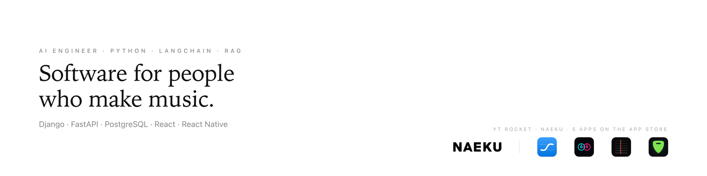

# Juan Pablo Pérez

AI engineer. Python, LangChain, RAG. Full-stack developer at **YT Rocket** and **Naeku**.
I build apps for musicians and the back-office software that pays them.

## What I work on

- **Royalty and distribution software** at Naeku: splits, advances, monthly compensation runs, statements. Money is `NUMERIC`, every run is idempotent, every change ships with a rollback.
- **Apps for musicians**, built alone with React Native and Expo. Free, no ads, no accounts, audio processed on the device:
  - [canta](https://apps.apple.com/us/app/canta-learn-to-sing-in-tune/id6799558463): listens while you sing and explains *why* you were off, not just a score.
  - [Mezcla](https://apps.apple.com/us/app/mezcla-learn-to-dj-mix/id6799709948): two real decks and a coach that corrects you while you mix.
  - [Fretbox](https://apps.apple.com/us/app/fretbox-tab-player/id6807518389): plays the Guitar Pro and MusicXML files you already own. Loop, speed trainer, tuner.
  - [Backstage](https://apps.apple.com/us/app/backstage-music-business/id6799220609): 50 five-minute lessons on rights, money and contracts, built like a language app.
- **Agents and pipelines**: small fleets of coding and content agents on cloud GPUs, driven by queues and automatic gates (transcription, readability, structure) instead of hand approval.

## Public repositories worth a look

| Repo | What it is |
|---|---|
| [expo-alphatab](https://github.com/juapperez/expo-alphatab) | Guitar Pro / MusicXML / alphaTex scores in an Expo app: alphaTab inside a WebView, fully offline. The engine behind Fretbox. |
| [polyflow](https://github.com/juapperez/polyflow) | No-code trading automation for Polymarket: visual strategies, backtests on real data, TypeScript export. |
| [yield-kernel](https://github.com/juapperez/yield-kernel) | Self-custodial autonomous agent for DeFi yield, with a judge mode and an SSE autonomy stream. |
| [music-investment-solana](https://github.com/juapperez/music-investment-solana) | Anchor program + Next.js app: artists sell shares in a project, investors claim revenue. Devnet, hackathon. |
| [organize-classnames](https://github.com/juapperez/organize-classnames) | VS Code extension that sorts class names on save. [On the Marketplace](https://marketplace.visualstudio.com/items?itemName=juapperez.organize-classnames). |
| [Smart-image-optimizer](https://github.com/juapperez/Smart-image-optimizer) | WordPress plugin: WebP/AVIF for every image size, `<picture>` with safe fallbacks. |

Most of my day-to-day work lives in private company and client repositories.

## Stack

Python (Django, FastAPI, LangChain) · PostgreSQL · TypeScript (React, Next.js, React Native / Expo) · Swift / AppKit for macOS tools · Solana / Anchor · Cloudflare Workers · Google Cloud

## Elsewhere

- App Store: [all apps](https://apps.apple.com/us/developer/id6794666446)
- LinkedIn: [juanpabloperezdev](https://www.linkedin.com/in/juanpabloperezdev/)
- X: [@juapper](https://x.com/juapper)
- [naeku.io](https://naeku.io) · [ytrocket.com](https://ytrocket.com)
